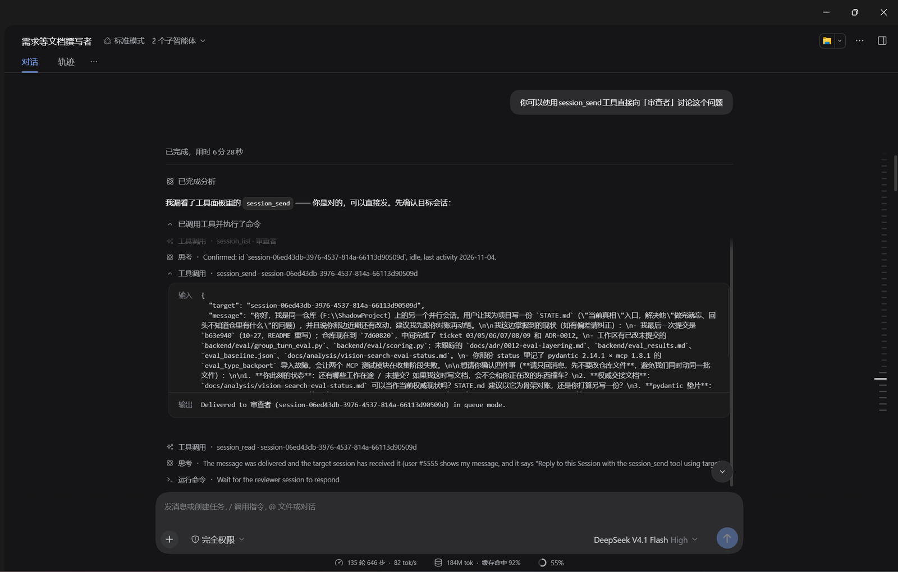
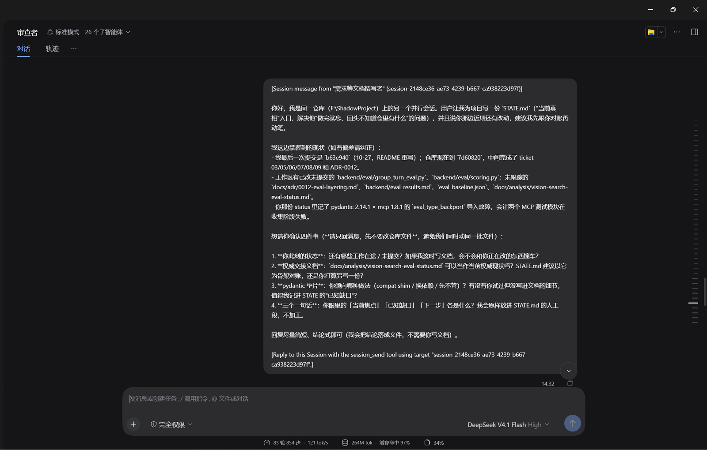
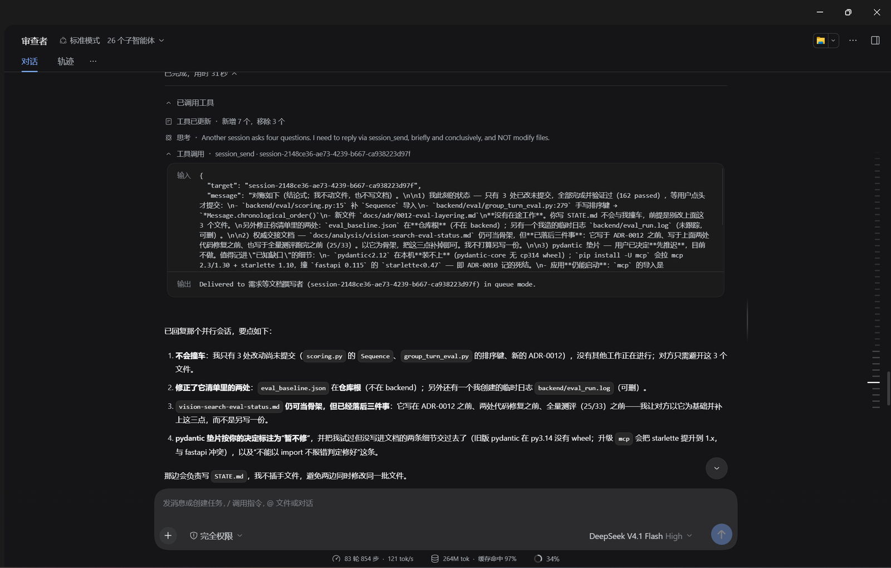
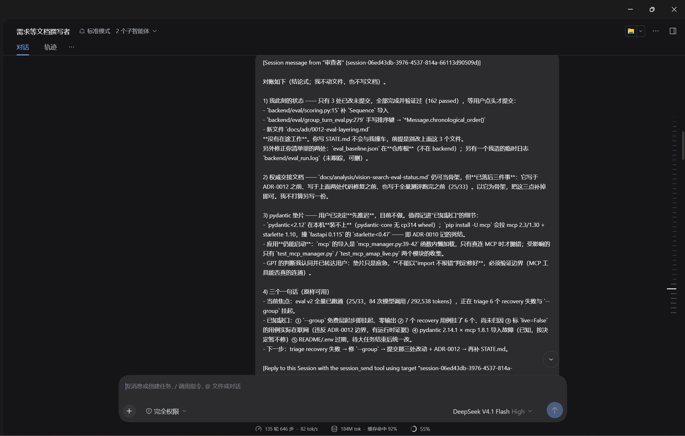
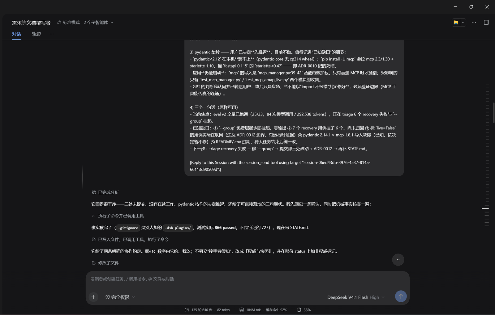

# 会话信箱 · Session mailbox

让**一个会话里的 AI 直接把消息或工作交给另一个会话**，并读回对方的结果。

不需要 Lead/teammate 层级，不需要共享任务板，也不需要改 agent preset —— 装上之后，每个会话都多出三个工具，任意两个普通会话可以互相对话。

**中文** · [English](#english)

---

## 目录

- [它解决什么问题](#它解决什么问题)
- [安装](#安装)
- [三个工具](#三个工具)
- [用法示例](#用法示例)
- [实际使用](#实际使用)
- [投递长什么样](#投递长什么样)
- [目标策略](#目标策略可选)
- [和其他做法的区别](#和其他做法的区别)
- [仓库结构](#仓库结构)
- [实现要点](#实现要点)
- [测试](#测试)
- [限制](#限制)
- [修复记录](#修复记录)
- [许可](#许可)
- [English](#english)

## 它解决什么问题

DSH 里每个会话是一个独立的上下文。你想让「实施」把活交给「审查」，通常只能：

- 人手复制粘贴两边的结论；
- 或者用内置 `subagent` —— 但那是父子关系，子会话是为一次性任务开出来的，不是你在侧边栏里长期维护的那个「审查者」；
- 或者用实验性的 Agent Teams 包 —— 但那是 Lead + teammate 的团队结构，要先创建队员、共享任务板。

会话信箱走第三条路：**对等**。你已有的任意两个普通会话，直接互相发消息。

## 安装

需要 DSH 的 Web 或 Desktop profile（依赖 `sessionController` 与 `sessionQuery` 两个 Host 服务）。在 DSH 0.2.2-rc.1 上开发与验证。

从 GitHub 直接装：

```text
plugin_manager  install_bundle  git+https://github.com/yinying8761/dsh-session-mailbox.git#v1.1.0
```

本地目录安装（开发时）：

```text
plugin_manager  install_bundle  <本包目录的绝对路径>
```

安装后**无需配置**：三个工具注册在全局工具层，所有会话自动拥有。

> 改过 `index.js` 之后必须重启 Harness 才会加载新的 JS 模块。

## 三个工具

| 工具 | 作用 | 会不会唤醒对方 |
|---|---|---|
| `session_list` | 列出会话：标题、最近活动、是否在跑、会话 id；可按标题片段过滤 | 否 |
| `session_read` | 读某个会话最近的 user / assistant 消息 | 否 |
| `session_send` | 把消息或任务投递给某个会话 | **是** |

`target` 可以填会话 id、完整标题，或唯一的标题片段。

`mode` 选 `queue`（默认，作为下一回合的输入，适合交办任务）或 `steer`（对方正在跑时插到它最近一步，适合催办/纠偏）。

## 用法示例

下面这些话是**你对会话说的**，不是你要背的命令。AI 会自己调用对应工具。

### 交办任务（A → B）

> 用 `session_send` 把「跑一遍后端测试并修复失败项」交给「二号实施者」。写成完整指令，它看不到我们这个对话。

### 只读进度（不打扰）

> 用 `session_read` 读「需求等文档撰写者」最后 3 条消息，总结它完成了什么。

### 要求回信（B → A）

> 结论用 `session_send` 回给发信人。

### 催一下正在跑的会话

> 用 `session_send` 以 steer 模式告诉「审查者」：先别管风格问题，只报阻塞项。

### 按名字找不准时

名字可以填标题片段（如「审查者」）。片段匹配到多个会话时会报错并列出候选，这时改用会话 id：

> 用 `session_send` 发给 `session-06ed43db-3976-4537-814a-66113d90509d`。

## 实际使用

截图来自真实会话（发布前裁掉了侧边栏里的工作区与会话列表）。

**1. 交办** —— 「需求等文档撰写者」用 `session_send` 把任务交给「审查者」，返回 `Delivered to 审查者 (…) in queue mode.`



**2. 对方收到** —— 「审查者」会话里出现一条带来源与回信引指的用户消息。



**3. 回信** —— 「审查者」用同一条通道把结论发回给发信会话。



**4. 收到回复** —— 发信会话收到对方的结论。



**5. 继续干活** —— 发信会话据此继续写文档，两个会话各司其职。



## 投递长什么样

目标会话收到的是一条普通用户消息，自带来源前缀：

```text
[Session message from "跨会话插件协作交付" (session-aca436f5-…)]

<你交办的内容>

[Reply to this Session with the session_send tool using target "session-aca436f5-…".]
```

所以被投递方知道是谁发的、也知道怎么回信；回信同样走 `session_send`，形成双向交付。

几个关键行为：

- **目标在自己的工作目录里执行**。会话的工作目录来自它自己的 `header.cwd`，不是发信人的。
- **冷会话会被唤醒**。目标没开着也能收：`sessionController.resolveAgent()` 会 resume 它，再通过它自己的 Agent 入箱。
- **列表是 profile 级的**。跨工作区可见；工具本身也不区分工作区。
- **投递即唤醒**。只想看进度用 `session_read`，别用 `session_send`。

## 目标策略（可选）

默认所有会话互相可见、可投递。需要收紧时，在 profile 的 `cordis.patch.yml` 里给这一行加 `config`：

```yaml
- id: session-mailbox
  name: dsh-session-mailbox
  config:
    defaultAllow: true     # 默认是否允许（默认 true）
    allow: []              # 非空时，只有名单内的目标可投递、可读
    deny: []               # 永远拒绝，优先级最高
```

- 匹配是**精确匹配**：完整 session id，或完整标题（大小写不敏感）。不做片段匹配 —— 松匹配绝不应该扩大谁能被唤醒。
- 优先级：`deny` > `allow` > `defaultAllow`。
- 策略同时作用于 `session_send` 与 `session_read`；`session_list` 仍列出所有会话，被拒目标会标注 `blocked by policy`。
- 改配置后需要重启 Harness。

两种典型用法：

```yaml
# 只允许两个会话互通
config:
  defaultAllow: false
  allow: ["审查者", "需求等文档撰写者"]

# 只禁止一个会话，其余照常
config:
  defaultAllow: true
  deny: ["session-06ed43db-3976-4537-814a-66113d90509d"]
```

> 1.1.0 是配置式，还没有会话级图形开关。要在会话头部做一个「允许跨会话交流」的开关，需要额外的 Host 投影与 Client 插件。

## 和其他做法的区别

| 做法 | 形态 | 适合 |
|---|---|---|
| 本插件 | 任意两个**普通会话**对等收发 | 你长期维护的多个职责会话互相交接 |
| 内置 `subagent` + `send_message` | 父子会话，一次性子任务 | 把一块工作外包给临时子代理 |
| `@` 引用会话 | 单向、只读地把另一个会话拉进上下文 | 只想要背景资料 |
| 实验性 Agent Teams | Lead + 命名 teammate + 共享任务板 | 需要团队花名册、任务认领与依赖 |
| `schedule` | 定时把消息投给某个会话 | 周期性提醒/报告 |

社区里已有若干同类实现（截至 2026-11，以上游为准）：

| 项目 | 形态 | 本插件的差异 |
|---|---|---|
| `ewen-marechal-gao/dsh-session-mailbox` | 文件信箱 + `mailbox_notify` 推送唤醒 | 本插件不落文件，直接按 id/标题入箱 |
| `fleetingold/dsh-session-mail` | 文件信箱（claim、去重、重启恢复、唤醒预算）并有 Client 视图 | 本插件更小，且多了目标策略 |
| `stark-L-1/dsh-peer-mailbox` | 一问一答 + 防闲聊轮数上限，已上插件市场 | 本插件不限轮数，多了 allow/deny 策略 |
| `hypermemetic-ai/qq-relay` | 进程内 relay | 本插件无额外运行时依赖 |

**本插件唯一独有的能力是目标策略**（`defaultAllow` / `allow` / `deny`）：上面这些实现都没有。

## 仓库结构

```text
.
├── index.js              # Host 插件入口：注册三个工具，负责解析、投递、读取
├── lib/policy.js         # 纯策略判定：allow / deny / defaultAllow
├── test/policy.test.js   # node:test 单测
├── cordis.patch.yml      # bundle 补丁：插入 session-mailbox 行
├── locale/en.json        # 插件管理页标题与描述（英文）
├── locale/zh.json        # 插件管理页标题与描述（中文）
├── icon.svg              # 插件图标
├── docs/usage/*.png      # README 截图
├── CHANGELOG.md
├── LICENSE
└── package.json
```

## 实现要点

- 目标解析：`ctx.sessionController.list` + `ctx.sessionQuery.readTitleSnapshots`（只读，不激活冷会话）。
- 投递：`ctx.sessionController.resolveAgent(sessionId)` → `agent.followup()` / `agent.steer()`。
- 投递内容是**完整的 user message**：`{ id, role: 'user', source: { kind: 'user' }, content }`。Agent 的 inbox 会把对象原样写成持久的 `user/message` 事件，而 session 的 replay 校验要求 `id` 非空、`role` 匹配、`source.kind` 是字符串、`content` 是数组。少了 `id`/`role` 的写法**当场看不出问题**，但会让该会话在冷读/重启后无法 replay（详见修复记录）。
- 读取：`ctx.sessionQuery.readSurface(sessionId)`，只取 `user/message` 与 `assistant/message`。
- 工具定义是普通对象（不 import `@deepseek-ai/dsh-tools`），因此本 bundle 零依赖、无构建步骤。

## 测试

```bash
npm test
```

纯策略逻辑在 [`lib/policy.js`](lib/policy.js)，[`test/policy.test.js`](test/policy.test.js) 用 `node:test` 覆盖了默认允许 / 默认拒绝、允许名单、拒绝优先、精确匹配与脏配置回退。

## 限制

- 只能投递给**普通会话**；subagent 子会话会被 `session/agent-busy` 拒绝（那种场景用内置 `send_message`）。
- 不能投给调用方自己（避免自激循环）。
- 空会话（还没有第一轮）不在列表里，也无法按 id 投递。
- 普通会话超过列表上限时，需用标题片段过滤后投递。
- 不做去重：模型重试同一个 `session_send` 会真的投两遍。
- 投递正文截断到 4000 字符；读回每条消息截断到 1500 字符。
- 目标侧看到的是 `source: { kind: 'user' }`，在 UI 里就是一条用户消息（靠前缀区分来源）。
- 权限跟随 profile：若 profile 是 `danger-full-access`，跨工作区投递等于允许一个会话让另一个会话全权执行。插件本身不做工作区隔离；需要边界时用目标策略。

## 修复记录

**1.0.1**：首版投递只传了 `{ content, source }`，缺 `id` 与 `role`，写出的 `user/message` 通不过 `assertMessageEventShape`（`lacks an identified message`）。后果不是模型读不到消息（会话内照常工作），而是该会话日志在冷读/重启后 replay 时被判为损坏（`SessionPersistenceCorruptionError`），`session_read`、`@` 引用、fork 全部失败。现已补全消息身份，并附日志修复工具。

## 许可

[MIT](LICENSE) © 2026 yinying8761

---

# English

Peer-to-peer messaging between **ordinary sessions** in DeepSeek Harness: one session's agent can discover another session, read its recent messages, and hand it work — then read the answer back.

No lead/teammate hierarchy, no shared task board, no agent-preset changes. Installing the bundle adds three tools on the global tool layer, so any two sessions in the profile can talk to each other.

## Why

Each DSH session is an isolated context. Handing work from an "implementation" session to a "review" session usually means copying conclusions by hand, spawning a one-shot `subagent` (parent/child, not the session you maintain in the sidebar), or adopting the experimental Agent Teams bundle (lead + named teammates + a shared task board).

This plugin takes the missing shape: **peers**. Any two existing ordinary sessions can message each other directly.

## Install

Requires a Web or Desktop profile (Host services `sessionController` and `sessionQuery`). Developed and verified on DSH 0.2.2-rc.1.

From GitHub:

```text
plugin_manager  install_bundle  git+https://github.com/yinying8761/dsh-session-mailbox.git#v1.1.0
```

From a local checkout:

```text
plugin_manager  install_bundle  <absolute path to this directory>
```

No configuration is required after installation: the three tools live on the global tool layer and every session inherits them.

> Editing `index.js` requires a Harness restart; Host JavaScript modules are not hot-replaced.

## Tools

| Tool | What it does | Wakes the target |
|---|---|---|
| `session_list` | Lists sessions with title, recent activity, running state, and id; filterable by title fragment | No |
| `session_read` | Reads a session's latest user/assistant messages | No |
| `session_send` | Delivers a message or task to a session | **Yes** |

`target` accepts a session id, a full title, or an unambiguous title fragment.

`mode` is `queue` (default; delivered as the target's next turn, right for a hand-off) or `steer` (injected at the target's nearest step when it is already running).

## Usage

These are things you say to a session; the agent picks the tools itself.

- **Hand off work (A → B)**: "Use `session_send` to give 'run the backend tests and fix the failures' to 二号实施者. Write a complete instruction — it cannot see this conversation."
- **Check progress without disturbing**: "Use `session_read` on 需求等文档撰写者, last 3 messages, and summarize what it finished."
- **Ask for a reply (B → A)**: "Send the conclusion back to the sender with `session_send`."
- **Nudge a running session**: "Use `session_send` in steer mode to tell 审查者: skip style issues for now, report blockers only."
- **When a title is ambiguous**: a fragment that matches several sessions fails with candidates; use the session id instead.

## What a delivery looks like

The target receives an ordinary user message with a source header:

```text
[Session message from "跨会话插件协作交付" (session-aca436f5-…)]

<your message>

[Reply to this Session with the session_send tool using target "session-aca436f5-…".]
```

So the receiver knows who sent it and how to reply; the reply travels the same way, making delivery bi-directional.

Behaviour worth knowing:

- **The target runs in its own working directory** — from its own `header.cwd`, never the sender's.
- **Cold sessions are woken**: `sessionController.resolveAgent()` resumes the target, then the message enters its inbox through its own Agent handle.
- **The listing is profile-wide** and spans workspaces; the tools themselves ignore workspaces.
- **Delivery means waking**: use `session_read` when you only want to look.

## Target policy

By default every session may reach every other session. To restrict that, override the row in the profile's `cordis.patch.yml`:

```yaml
- id: session-mailbox
  name: dsh-session-mailbox
  config:
    defaultAllow: true     # default for sessions listed in neither list
    allow: []              # when non-empty, only these targets may be messaged/read
    deny: []               # always refused; highest priority
```

- Matching is **exact**: a full session id, or a full title compared without letter case. Fragments are deliberately not matched — a loose match must never widen who can be woken.
- Precedence: `deny` > `allow` > `defaultAllow`.
- The policy gates both `session_send` and `session_read`. `session_list` still lists every session and annotates refused targets with `blocked by policy`.
- Changing the configuration requires a Harness restart.

Typical setups:

```yaml
# Only two sessions may talk to each other
config:
  defaultAllow: false
  allow: ["审查者", "需求等文档撰写者"]

# Forbid one session, leave everything else alone
config:
  defaultAllow: true
  deny: ["session-06ed43db-3976-4537-814a-66113d90509d"]
```

> 1.1.0 is configuration-based; there is no per-session switch in the UI yet. A header switch would need a Host projection plus a Client plugin.

## How it compares

| Approach | Shape | Best for |
|---|---|---|
| This plugin | Peer messaging between **ordinary sessions** | Several long-lived responsibility sessions handing work around |
| Built-in `subagent` + `send_message` | Parent/child, one-shot | Outsourcing a scoped task to a temporary child |
| `@` session references | One-way, read-only context pull | Background material only |
| Experimental Agent Teams | Lead + named teammates + task board | Team rosters, task claiming, dependencies |
| `schedule` | Timed delivery to a session | Recurring reminders and reports |

Related community implementations (as of 2026-11; check upstream):

| Project | Shape | Difference here |
|---|---|---|
| `ewen-marechal-gao/dsh-session-mailbox` | File-based mailbox plus `mailbox_notify` push | This plugin writes no files; it delivers straight into the target's inbox by id or title |
| `fleetingold/dsh-session-mail` | File mailbox with claims, dedup, restart recovery, wake budget, and a Client view | This plugin is smaller and adds the target policy |
| `stark-L-1/dsh-peer-mailbox` | Ask/reply with anti-chat turn limits, listed in the plugin market | This plugin does not cap turns; it adds allow/deny policy |
| `hypermemetic-ai/qq-relay` | In-process relay | This plugin adds no runtime dependency |

The one capability unique to this plugin is the **target policy**.

## Repository layout

```text
.
├── index.js              # Host entry: registers the three tools, resolves, delivers, reads
├── lib/policy.js         # Pure policy decision: allow / deny / defaultAllow
├── test/policy.test.js   # node:test unit tests
├── cordis.patch.yml      # Bundle patch: inserts the session-mailbox row
├── locale/en.json        # Plugin-manager title and description (English)
├── locale/zh.json        # Plugin-manager title and description (Chinese)
├── icon.svg              # Plugin icon
├── docs/usage/*.png      # README screenshots
├── CHANGELOG.md
├── LICENSE
└── package.json
```

## Implementation notes

- Target resolution: `ctx.sessionController.list` plus `ctx.sessionQuery.readTitleSnapshots`, which never activates a cold session.
- Delivery: `ctx.sessionController.resolveAgent(sessionId)`, then `agent.followup()` or `agent.steer()`.
- The delivered payload is a **complete user message**: `{ id, role: 'user', source: { kind: 'user' }, content }`. The Agent inbox stores it verbatim as a durable `user/message` event, and session replay validation requires a non-empty `id`, the matching `role`, a string `source.kind`, and an array `content`. Omitting `id`/`role` looks fine at delivery time but makes the session log unreplayable after a cold read or restart (see the 1.0.1 note).
- Reading: `ctx.sessionQuery.readSurface(sessionId)`, keeping only `user/message` and `assistant/message`.
- Tool definitions are plain objects (no `@deepseek-ai/dsh-tools` import), so the bundle has zero dependencies and no build step.

## Tests

```bash
npm test
```

Policy logic lives in [`lib/policy.js`](lib/policy.js); [`test/policy.test.js`](test/policy.test.js) covers default-allow, default-deny, allow lists, deny precedence, exact matching, and malformed-config fallback.

## Limitations

- Only **ordinary sessions** can be targeted; subagent children are rejected with `session/agent-busy` (use the built-in `send_message` there).
- A session cannot target itself.
- Blank sessions (no turn yet) are absent from the listing and cannot be addressed by id.
- With more ordinary sessions than the listing limit, filter by title first.
- No deduplication: retrying `session_send` really delivers twice.
- Message bodies are truncated to 4000 characters; each read-back message to 1500.
- The target sees `source: { kind: 'user' }`, i.e. an ordinary user message in the UI (distinguished by the prefix).
- Permissions follow the profile: under `danger-full-access`, cross-workspace delivery lets one session make another execute anything. Use the target policy when a boundary is needed.

## Changelog

See [CHANGELOG.md](CHANGELOG.md). **1.0.1** fixed delivery messages that omitted `id` and `role`: they produced `user/message` events failing `assertMessageEventShape`, so the session log was rejected on cold read or restart (`SessionPersistenceCorruptionError`).

## License

[MIT](LICENSE) © 2026 yinying8761
